# Matchday Studio – User Guide

**Kildrum Utd 2012 · CLYFA Division D**

This guide explains how to use Matchday Studio. It has two parts:

- **Part 1 – For parents, players and supporters:** following the league, fixtures, results and the weekly squad announcement.
- **Part 2 – For the coach (admin):** building the squad graphic, recording the match, creating the result graphic and publishing the league data.

> **Note:** the player names in the screenshots have been replaced with "Player A, Player B…". League data (teams, scores, fixtures) is real as at 17 November 2026, so your screen will show newer figures.

---

## Contents

1. [Getting started](#getting-started)
2. [Part 1 – Parents and supporters](#part-1--parents-and-supporters)
3. [Part 2 – Coach tools](#part-2--coach-tools)
4. [Suggested match-week routine](#suggested-match-week-routine)
5. [Tips and troubleshooting](#tips-and-troubleshooting)

---

## Getting started

Matchday Studio is a web page. It works on a phone, tablet or computer and needs no installation.

There are two ways to open it:

| Link | Who it is for | What you see |
|---|---|---|
| The normal web address | Coach | League plus the locked coach tools |
| The same address with **`?view=league`** on the end | Parents and supporters | League and Help only. All coach tools are hidden. |

**Tip for the coach:** share the `?view=league` link in the parents' group chat so parents never see the coach tools.

The top bar has these buttons:

- **League** – the table, fixtures, results and statistics (open to everyone).
- **Lineup Generator**, **Result & Match Report**, **Match Recorder** – coach tools, marked with a padlock until unlocked.
- **Help** – opens the information page from the GitHub README.

---

## Part 1 – Parents and supporters

### 1. The league table

Open the app and you land on the **League** tab, **Table** view.

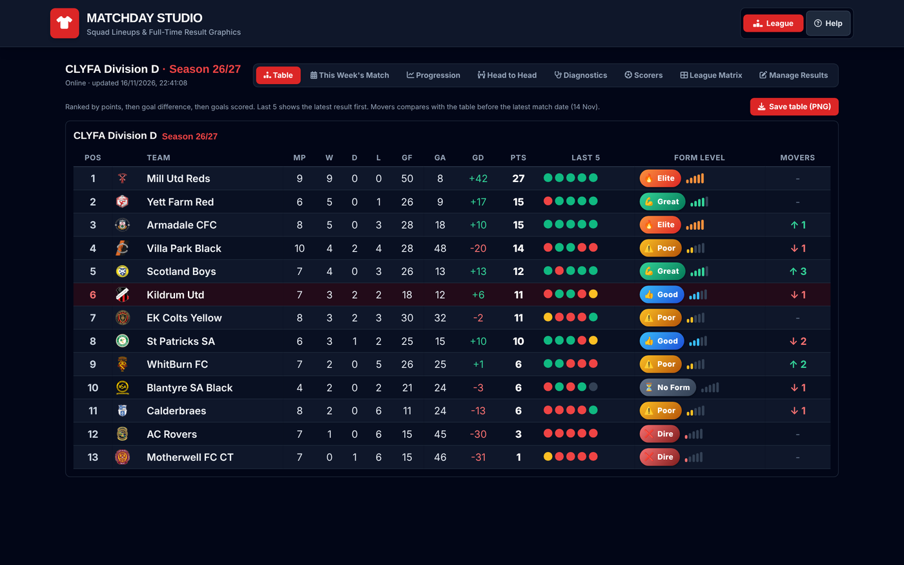

| Column | Meaning |
|---|---|
| POS | League position |
| MP / W / D / L | Matches played, won, drawn, lost |
| GF / GA / GD | Goals for, goals against, goal difference |
| PTS | Points |
| LAST 5 | Latest five results (green = win, amber = draw, red = loss) |
| FORM LEVEL | A label from *Dire* to *Elite*, based on recent results |
| MOVERS | Places gained or lost since the previous match date |

The table is ranked by points, then goal difference, then goals scored. Kildrum Utd is highlighted in red. **Save table (PNG)** downloads the table as a picture you can share.

### 2. A team's results and fixtures

Tap or click any team name to open its panel.

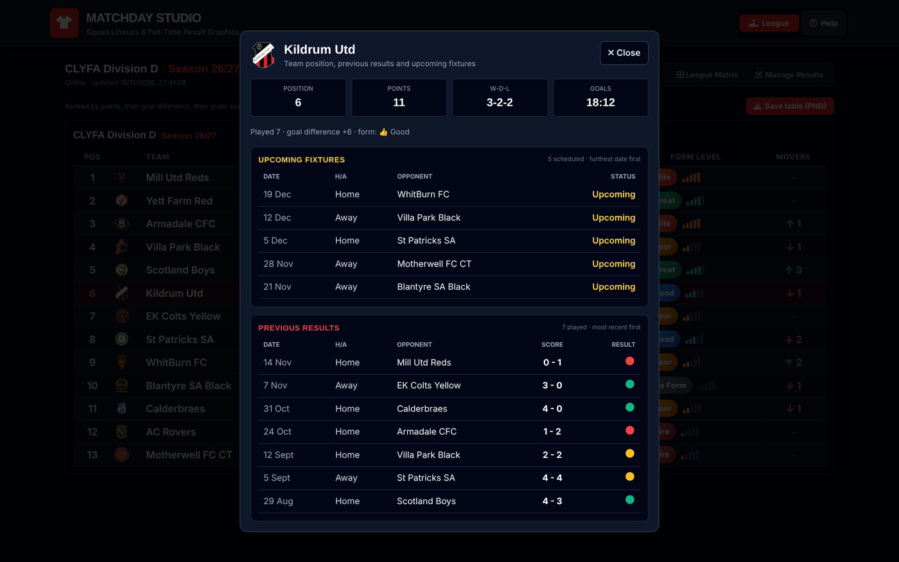

The panel shows the team's position, points, record and goals, then:

- **Upcoming fixtures** – date, home or away, and opponent.
- **Previous results** – date, opponent, score and a coloured circle (green win, amber draw, red loss).

Fixtures can change, so always check before travelling. Tap **Close** to return to the table.

### 3. This Week's Match

Shows Kildrum's next fixture: opponent, date, kick-off time and venue.

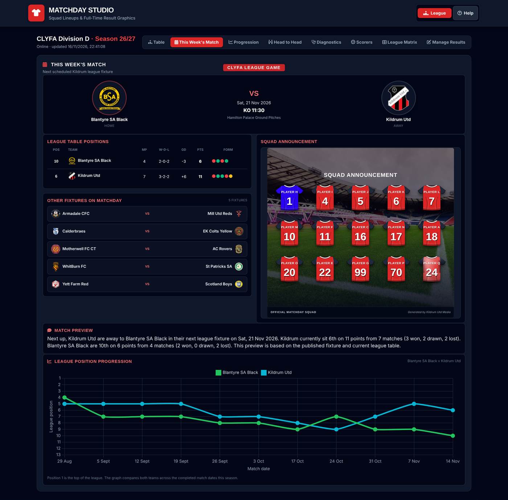

It also shows:

- The **league positions** of both teams.
- **Other fixtures on matchday.**
- The **Squad Announcement** graphic, once the coach has published it.
- An automatic **Match Preview** and a **position graph** comparing the two teams.

If no squad is shown, the coach has not published it yet.

### 4. More league views

Use the buttons along the top of the League page to switch views.

**Progression** – how every team's league position has changed through the season. Use *By match date* or *By games played*, and tap team names to show or hide lines.

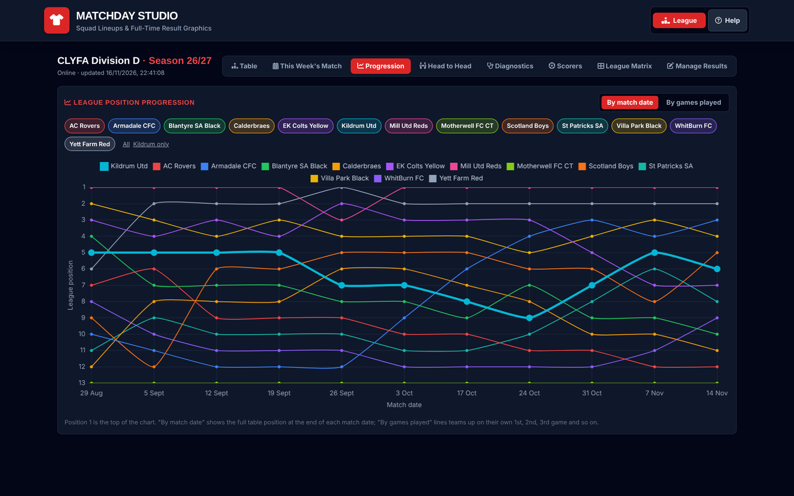

**Head to Head** – pick any two teams to compare their records side by side, see direct meetings this season, common opponents and a position graph.

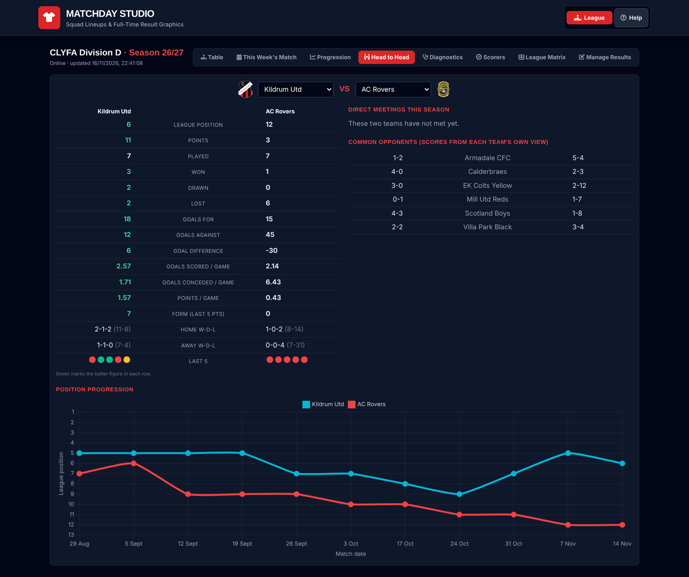

**Diagnostics** – league-wide statistics: clean sheets, best attack and defence, biggest wins, highest-scoring games, goals scored and conceded per team, points after each match date and automatic data checks.

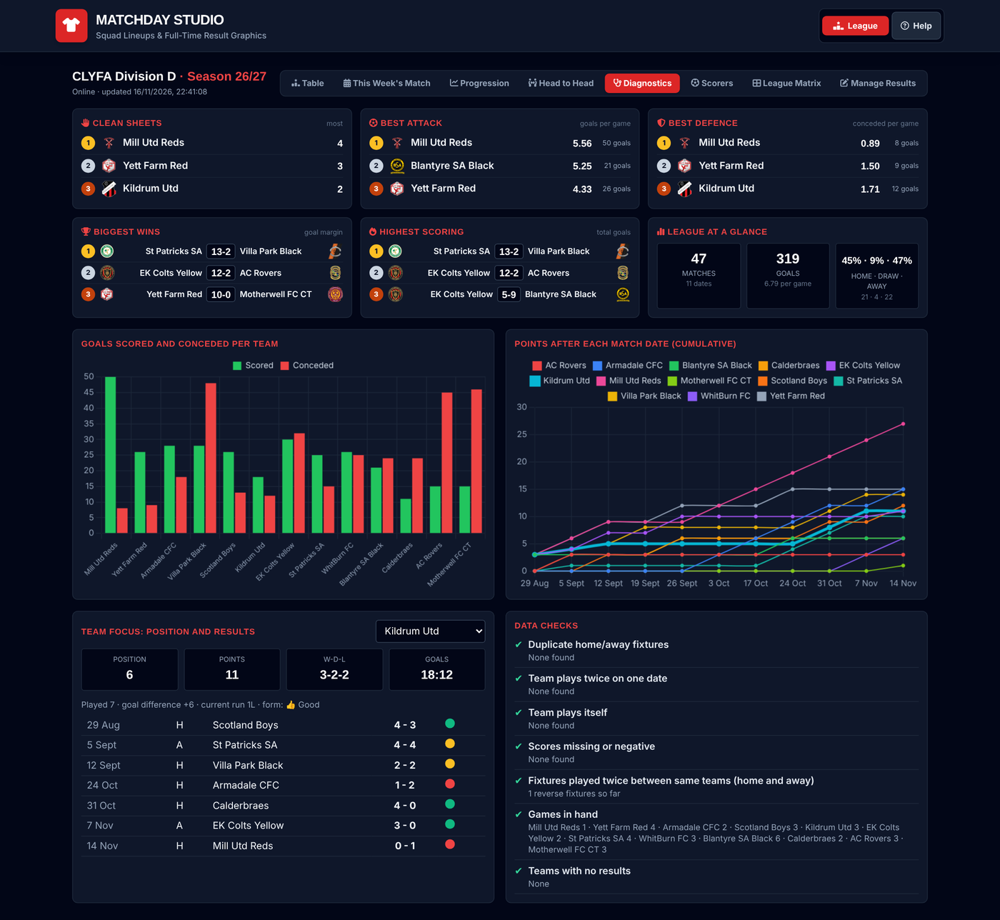

**Scorers** – leading scorers, most goals in a game, doubles, hat-tricks, assists and a full goalscorer table. Choose a player in *Player focus* to see their goals match by match.

> Only matches where the coach has recorded scorers are counted. This is shown under *Scorers at a glance*.

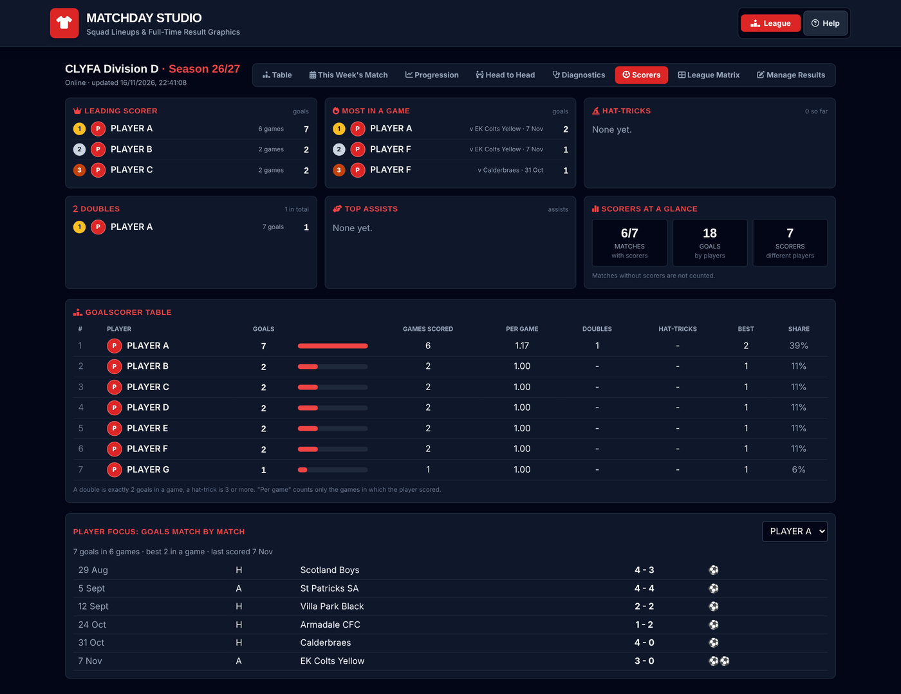

**League Matrix** – a grid of every home and away result between teams, so you can see at a glance who has played whom.

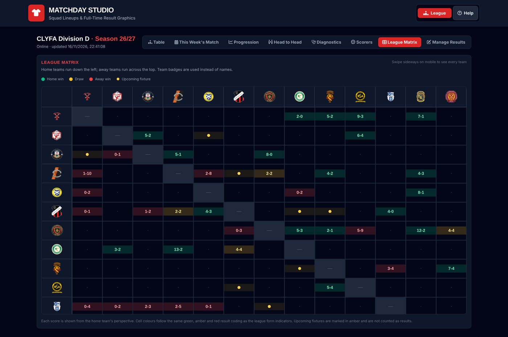

### 5. Help

Tap **Help** (top right) for the information page. It is read live from the club's GitHub README, so it is always up to date. Use **Refresh** to reload it and **Close** to go back.

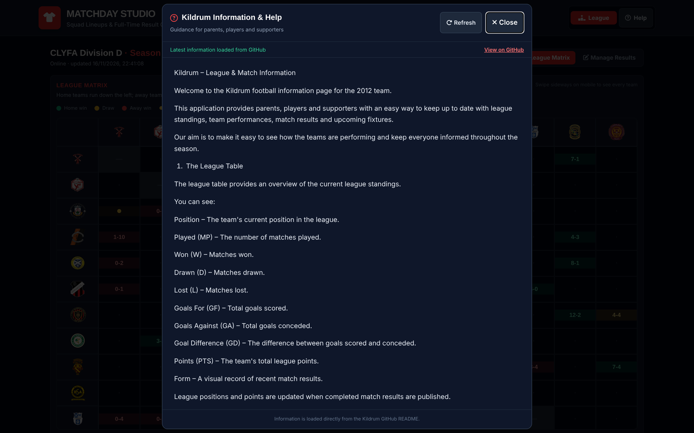

---

## Part 2 – Coach tools

### Unlocking the coach tools

The Lineup Generator, Result & Match Report, Match Recorder and Manage Results are protected. Until you unlock them they are view-only.

1. Tap **Lineup Generator** (or any padlock tab).
2. Paste your **GitHub access token** into the box and press **Unlock** (or press Enter).
3. The tools open. The app remembers the token on that device, so you only do this once per device.

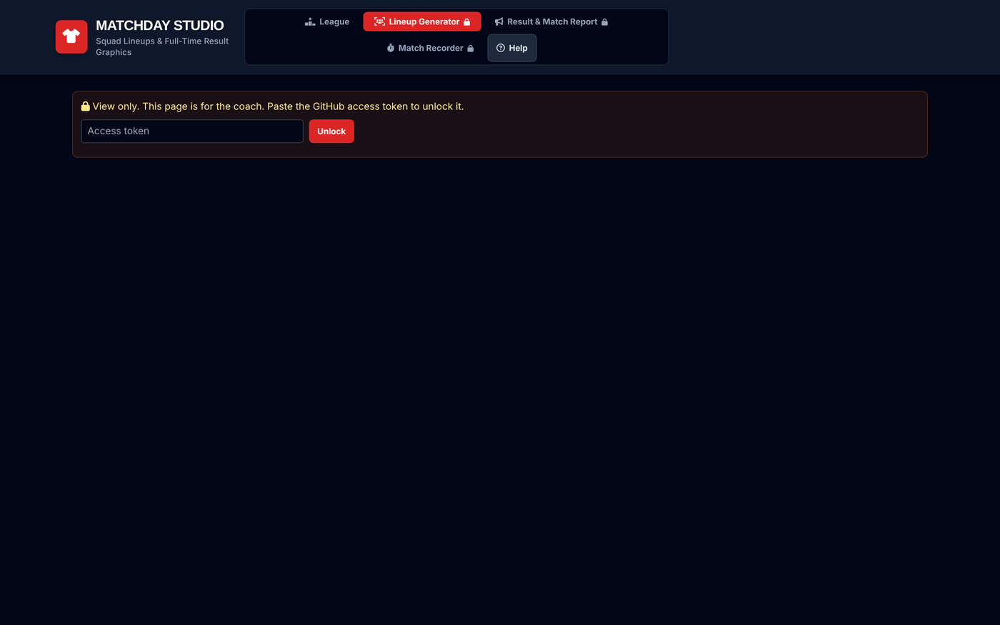

The token must have **Contents: Read and write** permission on the `Kildrum-2012` repository. If it is rejected, check the token has not expired and has that permission. Keep the token private. Anyone who has it can change the league data.

**Header buttons** (shown on the three coach tabs):

| Button | What it does |
|---|---|
| **Save Locally** | Keeps your current work on this device only. Nothing is published. |
| **Reset** | Puts the screen back to its defaults. |
| **Print** | Prints the current graphic. |
| **Save Graphic (PNG)** | Downloads the current graphic as a picture, ready to share. |

### 1. Lineup Generator

Creates the squad announcement graphic.

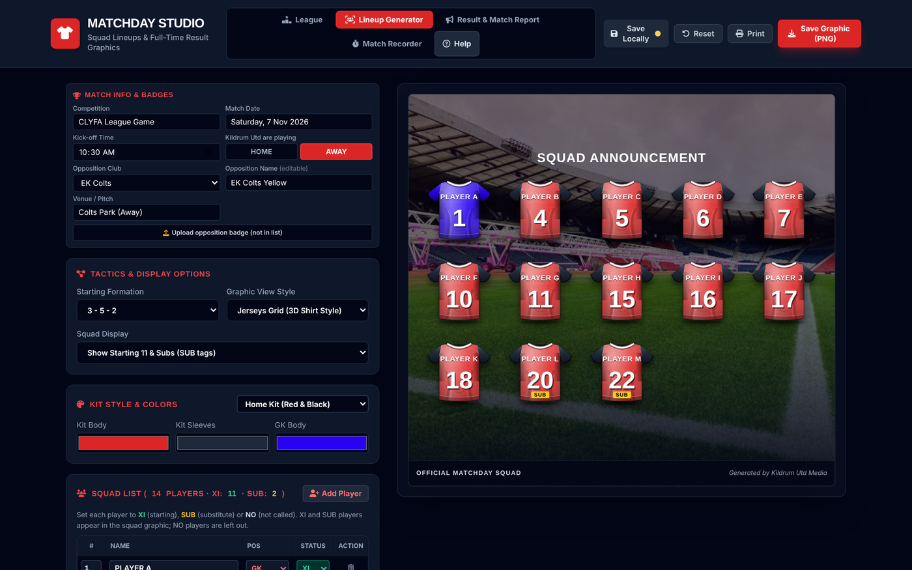

**Match Info & Badges**

- **Competition, Match Date, Kick-off Time, Venue** – type these in. They appear on the graphics.
- **Kildrum Utd are playing: HOME / AWAY** – sets which side Kildrum is on.
- **Opposition Club** – choose from the list to fill in the name and badge automatically. If the club is not listed, leave it on *Custom* and use **Upload opposition badge**.
- **Opposition Name** – editable, if you want different wording.

**Tactics & Display Options**

- **Starting Formation** – 4-4-2, 3-5-2, 4-3-3, 4-2-3-1, 3-4-3 or 5-3-2.
- **Graphic View Style** – *Jerseys Grid* (shirts with names and numbers) or *Tactical Pitch View* (players placed on a pitch).
- **Squad Display** – *Starting 11 & Subs* (substitutes get a SUB tag) or *Squad* (all called players, no tags).

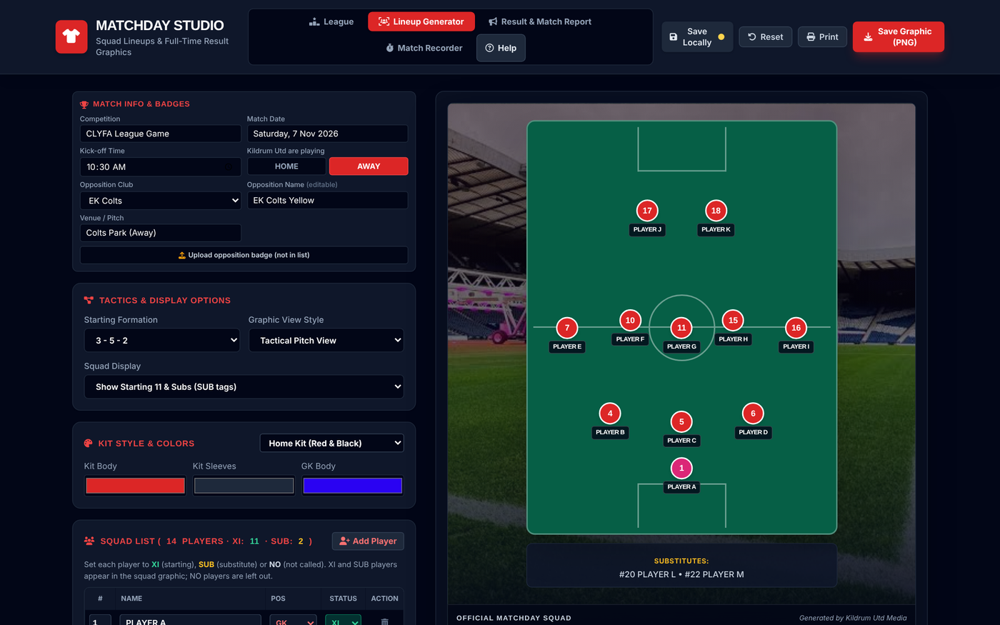

**Kit Style & Colors** – choose the Home or Away kit, or **Custom Colors** and pick the body, sleeve and goalkeeper colours.

**Squad List** – one row per player: shirt number, name, position and status.

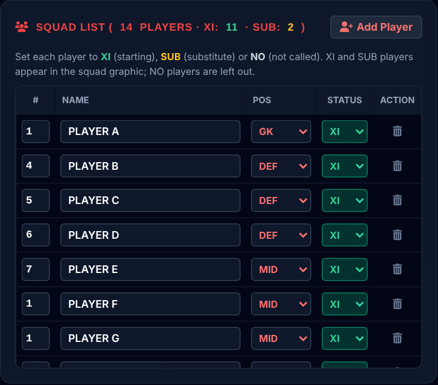

- Set each player to **XI** (starting), **SUB** (substitute) or **NO** (not in the squad). XI and SUB players appear on the graphic; NO players are left out.
- **Add Player** adds a new row. The bin icon removes a player.
- The heading shows the running count of players, XI and subs.

**Publish Squad Announcement**

This puts the squad graphic on the parents' *This Week's Match* card.

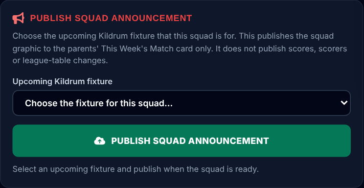

1. Finish the squad and opposition details.
2. Choose the **upcoming Kildrum fixture** from the drop-down.
3. Press **Publish Squad Announcement** and wait for the green confirmation message.

Things to know:

- It only publishes the squad. It does **not** publish scores, scorers or league-table changes.
- The fixture must already exist (add it under **League › Manage Results**) and must be today or later.
- The opposition needs a badge. Pick the club from the list or upload one first.

### 2. Result & Match Report

Creates the full-time result graphic and the WhatsApp text.

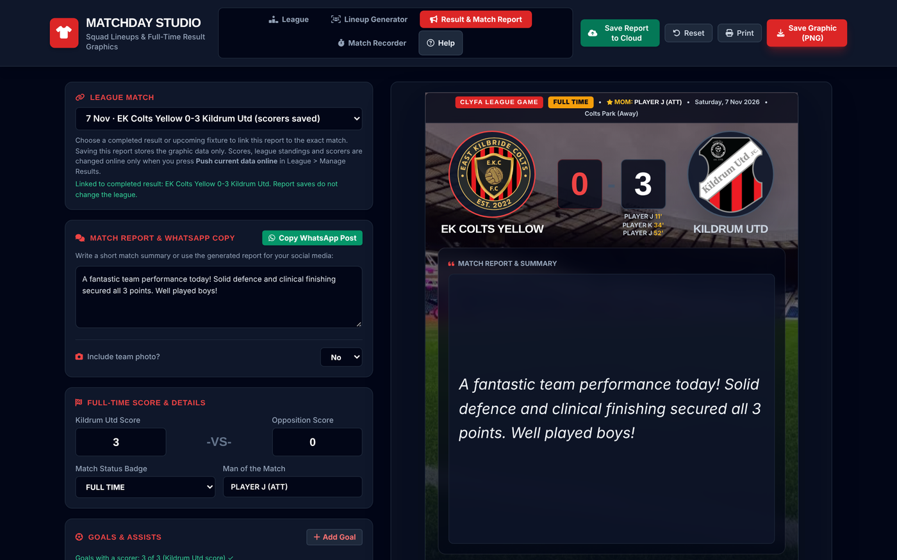

1. **League Match** – choose the match from the list. This fills in the opposition, side, date and score and links the report to the right league game.
2. **Full-Time Score & Details** – check the two scores. Set the **Match Status Badge** (Full Time, Half Time, Extra Time or Penalties) and the **Man of the Match**.
3. **Goals & Assists** – press **Add Goal** for each goal and enter the scorer, assist and minute.
4. **Match Report & WhatsApp Copy** – write a short summary. Press **Copy WhatsApp Post** to copy a ready-made message for the group chat.
5. **Include team photo?** – choose *Yes* and load a photo. It appears above the scoreline and the text resizes to fit.
6. Press **Save Graphic (PNG)** to download the result picture.

> **Important:** saving a report stores the graphic only. League scores, standings and scorers change online only when you press **Push current data online** in **League › Manage Results**.

### 3. Match Recorder

A live scorekeeper for use at the side of the pitch.

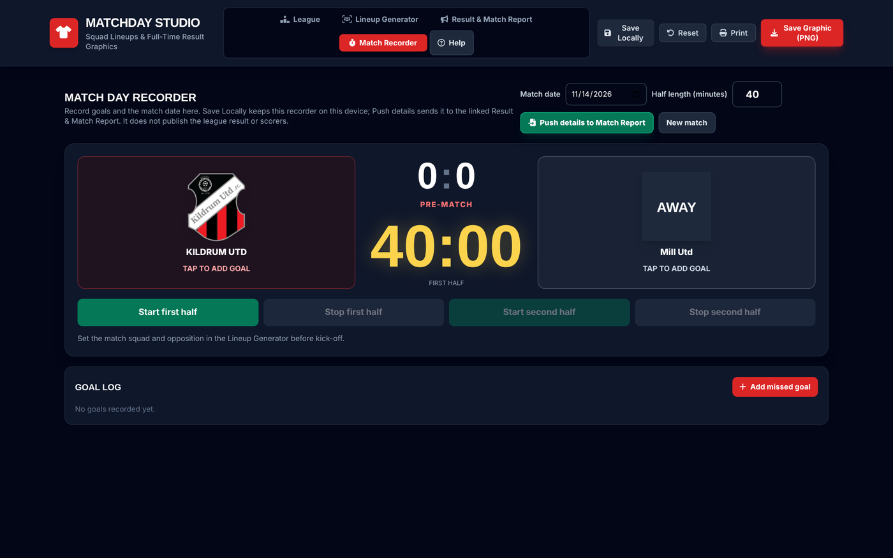

Before kick-off, set the squad and opposition in the Lineup Generator. The recorder uses that squad for its scorer list.

1. Check the **Match date** and **Half length** (40 minutes by default).
2. Press **Start first half**. The clock starts counting.
3. When Kildrum score, tap the **Kildrum Utd** panel. When the opposition score, tap the **opposition** panel.
4. For a Kildrum goal, a box asks who scored. Choose the scorer and press **Save goal**.

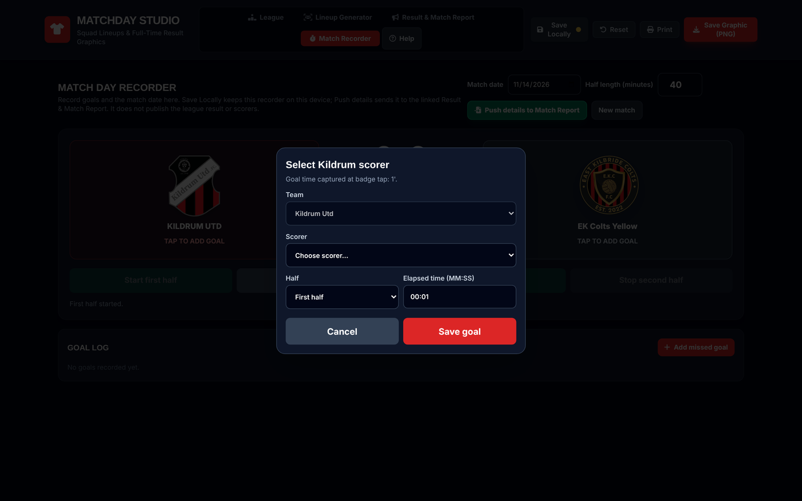

5. Press **Stop first half** at half-time, then **Start second half** and **Stop second half** at full time.

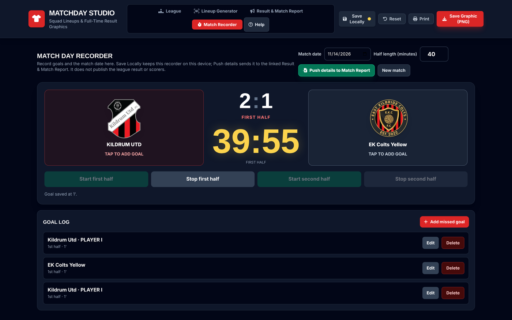

The **Goal Log** lists every goal with its half and time. Use **Edit** or **Delete** to correct mistakes, or **Add missed goal** if you forgot to tap one.

Buttons at the top:

- **Push details to Match Report** – sends the goals and date to the Result & Match Report tab so you do not have to type them again.
- **New match** – clears the recorder ready for the next game.
- **Save Locally** (header) – keeps the recording on this device.

> The recorder does **not** publish the league result or scorers. That is done in Manage Results.

### 4. Manage Results (publishing league data)

Found under **League › Manage Results**. It appears once you are unlocked.

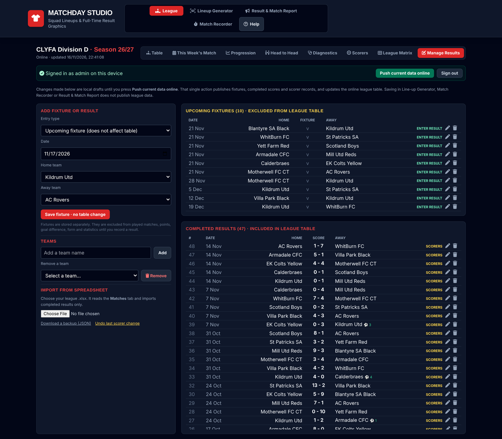

You will see a green message "Signed in as admin on this device" with the main button **Push current data online**.

> **How publishing works.** Everything you change here is a local draft until you press **Push current data online**. That single action publishes fixtures, completed scores and scorers, and updates the league table everyone sees.

**Add a fixture or a result** (left panel)

1. Set **Entry type**:
   - *Upcoming fixture* – does not affect the table.
   - *Completed result* – updates the league table.
2. Choose the date, home team and away team. For a result, also enter the home and away goals.
3. Press **Save fixture** or **Save result**.

**Edit or delete**

- Upcoming fixtures are listed at the top right. Use **Enter result** when a fixture has been played. It turns the fixture into a result.
- Completed results are listed below. Use the pencil to edit, the bin to delete, and **Scorers** to record who scored. A ⚽ number shows the match has scorers recorded.

**Teams** – add a team by name, or remove one. Removing a team also deletes its results and fixtures, and the app asks you to confirm first.

**Import from spreadsheet** – choose your league `.xlsx` file. It reads the **Matches** tab and imports completed results only.

**Safety nets**

- **Download a backup (JSON)** saves a copy of all the league data.
- **Undo last scorer change** reverses your most recent scorer edit.
- **Sign out** removes the token from this device.

---

## Suggested match-week routine

1. **Early in the week** – in *Manage Results*, add the fixture if it is not there, then **Push current data online**.
2. **Squad selection** – in *Lineup Generator*, pick the opposition, set the squad and kit, check the graphic, then **Publish Squad Announcement**. Use **Save Graphic (PNG)** to share it on WhatsApp.
3. **During the match** – in *Match Recorder*, start each half and tap goals as they happen.
4. **After the match** – press **Push details to Match Report**. In *Result & Match Report*, check the score, add Man of the Match and a summary, then **Save Graphic (PNG)** and **Copy WhatsApp Post**.
5. **Update the league** – in *Manage Results*, enter the result (or press **Enter result** on the fixture), add the scorers, then **Push current data online**.

---

## Tips and troubleshooting

| Problem | What to try |
|---|---|
| The coach tabs are greyed out with a padlock | Unlock with the GitHub token (see *Unlocking the coach tools*). |
| "That token was not accepted" | Check the token has not expired and has **Contents: Read and write** on the `Kildrum-2012` repository. |
| The squad does not show on *This Week's Match* | Publish it from the Lineup Generator, choosing the right upcoming fixture. |
| "No badge is available for…" when publishing | Select the club from *Opposition Club* or upload its badge. |
| The league table did not change after saving a report | Reports never change the league. Press **Push current data online** in Manage Results. |
| Parents can see the coach tools | Give them the link ending **`?view=league`**. |
| Changes seem to be missing | Refresh the page. Use **Save Locally** to keep a draft on the device, and check you are online before publishing. |
| Help panel will not load | Press **Refresh** in the Help panel, or open the README on GitHub using **View on GitHub**. |

---

*Cheers Craig – Come on Kildrum!*
